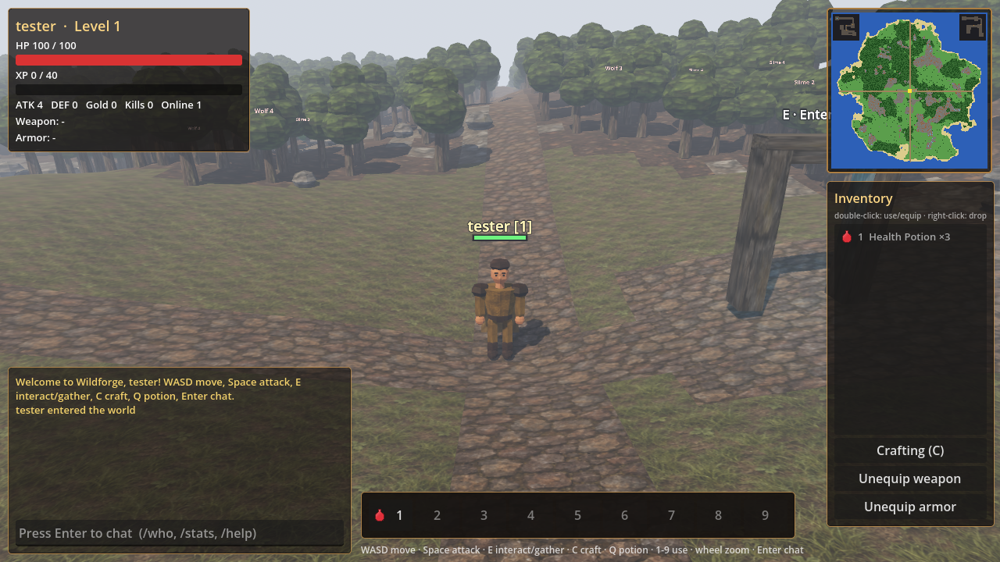
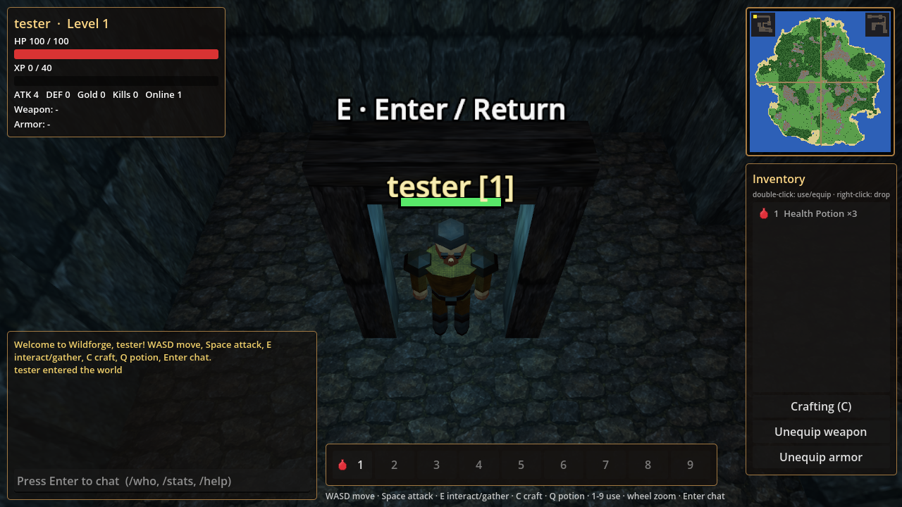

<div align="center">

# WILDFORGE

**Мир над землёй. Тайны под ней.**

Многопользовательская low-poly RPG с процедурным островом, подземельями и атмосферой старых фэнтезийных игр.

**Godot 4 · Rust · Go · MIT**

[Запуск](#быстрый-старт) · [Управление](#управление) · [Подземелья](docs/DUNGEONS.md) · [Архитектура](docs/ARCHITECTURE.md) · [Дизайн](docs/art/README.md)

</div>



## Исследуй, собирай, создавай

Процедурный остров объединяет леса, каменистые земли, берега и дороги.
Собирай ресурсы, создавай снаряжение и отправляйся в подземелья вместе с другими игроками.

| Мир | Приключение | Персонаж |
|---|---|---|
| Генерация острова по seed | Бои со слизнями, волками, скелетами и ограми | Уровни, опыт и экипировка |
| Рельеф, биомы и ресурсы | Комнаты и коридоры подземелий | Инвентарь и быстрые слоты |
| Туман и локальное освещение | Стражи, тайники и добыча | Крафт, зелья и сохранения |
| Общий серверный мир | Возвращение на поверхность через арки | Чат и таблица лидеров |

## Под землёй



Два входа находятся на дороге к востоку от точки появления, примерно в 5 и 10 тайлах.
Подойди к арке и нажми **E**. Внутри тебя ждут связанные коридорами комнаты,
стражи и тайники с золотом и лечебными зельями.

Нажми **E** рядом с тайником, чтобы забрать добычу, или у входной арки, чтобы вернуться.
Тайники общие для игроков и пополняются через пять минут.

## Быстрый старт

Проверенная среда — **Go 1.27.3**, **Rust stable** и **Godot 4.7.2**.
Клиент использует GDExtension API 4.6. Скрипты запуска рассчитаны на shell-окружение macOS/Linux.

### 1. Получи исходники

```bash
git clone https://github.com/villetacore/wildforge.git
cd wildforge
```

### 2. Запусти сервер

```bash
./scripts/run-server.sh
```

Сервер слушает порт **7777**, загружает данные из `content/`
и сохраняет аккаунты в `server/data/users.json`.

### 3. Открой клиент в другом терминале

```bash
./scripts/run-client.sh
```

Укажи `ws://127.0.0.1:7777/ws`, выбери логин и пароль, нажми **Create account**.
Для игры на другом сервере укажи его адрес вместо `127.0.0.1`.

Если Godot установлен вне стандартного пути, передай путь к исполняемому файлу
через переменную `GODOT`.

<details>
<summary><strong>Настройка сервера</strong></summary>

```bash
./scripts/run-server.sh -addr :7777 -data data/users.json -content ../content -seed 1337
```

| Параметр | Переменная окружения | Назначение |
|---|---|---|
| `-addr` | `WILDFORGE_ADDR` | адрес и порт |
| `-data` | `WILDFORGE_DATA` | файл аккаунтов |
| `-content` | `WILDFORGE_CONTENT` | каталог контента |
| `-seed` | `WILDFORGE_SEED` | генерация мира |

**Ctrl+C** завершает сервер с сохранением персонажей.
`GET /healthz` проверяет доступность, `GET /api/leaderboard` возвращает таблицу лидеров.

</details>

## Управление

| Клавиша | Действие |
|---|---|
| **WASD** / стрелки | движение |
| **Space** | атака ближайшего врага |
| **E** | добыча, вход/выход через арку, открытие тайника |
| **C** | крафт |
| **Q** | лечебное зелье |
| **1–9** | использование или экипировка предмета |
| Двойной клик по предмету | использование |
| Правый клик по предмету | выбросить |
| Колесо мыши | расстояние камеры |
| **Enter** | чат, команды `/who`, `/stats`, `/help` |

## Первые шаги

1. Собери дерево клавишей **E**. Создай деревянную кирку из 6 дерева и меч из 5.
2. Добывай камень и железо, чтобы улучшить инструменты, оружие и броню.
3. Побеждай врагов и собирай материалы для крафта.
4. Подготовь зелья и исследуй подземелья.
5. С железной киркой отправляйся за кристаллами в дальние скалы.

## Устройство проекта

| Каталог | Содержимое |
|---|---|
| [server/](server) | Go-сервер, авторитетная симуляция 20 тиков/с, WebSocket, сохранения |
| [client/rust/](client/rust) | Rust GDExtension, сцена, модели, интерфейс и сеть |
| [client/godot/](client/godot) | проект Godot |
| [content/](content) | JSON-описания предметов, рецептов, врагов и PNG-текстуры |
| [docs/art/](docs/art) | художественное направление и требования к ассетам |
| [art/source/](art/source) | исходники материалов и промпты генерации |

Определения контента передаются клиенту при входе. Новые типы моделей и механики
подключаются в коде. Источники сгенерированных текстур и их происхождение описаны
в [документации материалов](art/source/textures/retro-v1/README.md).

### Проверки

```bash
(cd server && go test -race ./...)
(cd client/rust && cargo fmt --check && cargo build --locked)
```

## Состояние разработки

Проект находится на стадии игрового прототипа. Скриншоты выше сняты в работающем
клиенте. Модели процедурные, подземелья показаны в разрезе, высота поверхности
используется для визуального рельефа при тайловых коллизиях. Таймеры тайников
сбрасываются после перезапуска сервера. Материалы и анимации продолжают развиваться.

[Художественный концепт](docs/art/references/wildforge-direction-v1.png)
задаёт направление дальнейшей работы.

---

Разработчик — **[villetacore](https://github.com/villetacore)**.
Код распространяется по лицензии [MIT](LICENSE).
