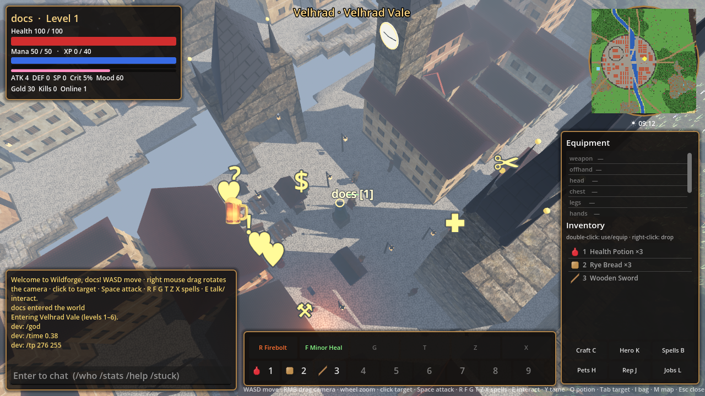
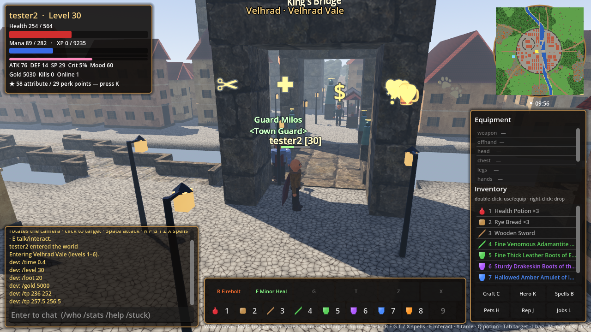
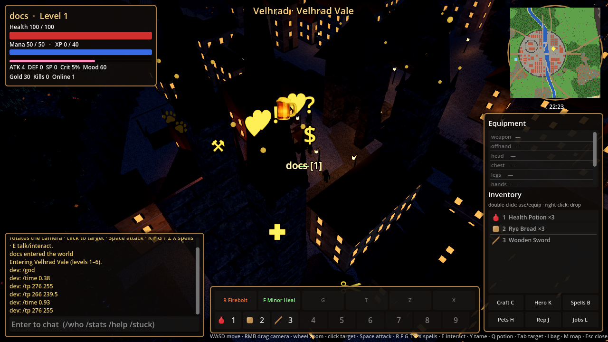
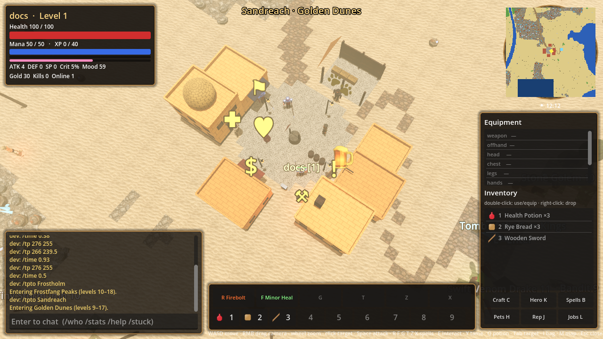

<div align="center">

# WILDFORGE

**Мир над землёй. Тайны под ней.**

Многопользовательская low-poly RPG: шесть зон, средневековая столица на реке,
процедурные подземелья, магия, перки, фракции, питомцы и миллион видов чудовищ.

**Godot 4 · Rust · Go · MIT**

[](https://github.com/villetacore/wildforge/actions/workflows/ci.yml)

[Запуск](#быстрый-старт) · [Управление](#управление) · [Мир](#мир) · [Системы](#системы) · [Подземелья](docs/DUNGEONS.md) · [Архитектура](docs/ARCHITECTURE.md) · [Дизайн](docs/art/README.md)

</div>



## Мир

Континент 512×512 тайлов разделён на шесть зон, как в классических MMO. В каждой
свой биом, диапазон уровней, город, фракция и подземелье.

| Зона | Уровни | Город | Фракция | Подземелье |
|---|---|---|---|---|
| Велградская долина — луга | 1–6 | **Велград**, столица | Корона Велграда | Катакомбы св. Войтеха |
| Темнохвойная чаща — лес | 4–11 | Торнвик, фахверк | Стражи Зелёного леса | Плачущая Лощина |
| Утонувшая топь — болото | 6–13 | Богмайр, хижины на сваях | Болотный народ | Затопленное аббатство |
| Золотые дюны — пустыня | 9–17 | Сандрич, песчаник | Караваны Песчаников | Гробница Солнечных королей |
| Морозные пики — снег | 10–18 | Фростхольм, северный | Кланы Морозных | Чертоги Ледяного короля |
| Пепельный предел — лава | 15–24 | Эмберхольд, базальт | Арканная коллегия | Кузня Пепельных |

**Велград** — стартовый город, вдохновлённый Прагой. Река Влтара делит его на два
берега. На западном — замковый холм с королевским дворцом и собором св. Войтеха с
медно-зелёными шпилями. На восточном — Староместская площадь: ратуша с
астрономическими курантами (стрелки идут по игровому времени), церковь с двумя
чёрными шпилями, памятник основателю, рыночные лавки. Берега соединяет
Королевский мост со статуями, фонарями и мостовыми башнями. Город окружён стеной
с воротами, плотно застроен домами с черепичными крышами. Ночью в окнах зажигается
свет, на улицах — фонари.





Дороги ведут из столицы во все города, через реки перекинуты мосты. Смена дня и
ночи длится 15 минут, туман и освещение меняются по зонам.

## Системы

| | |
|---|---|
| **Враги** | собираются из 15 семейств × 9 стихий × 6 рангов × 24 черт (до трёх сразу) — больше миллиона комбинаций. «Champion Ironhide Thorned Storm Wolf», «Elite Bloodthirsty Flame Wisp». Стихия даёт цвет, свечение, статус при ударе и сопротивления; черты — скорость, вампиризм, шипы, регенерацию, взрыв при смерти. Культисты, импы и огоньки атакуют издалека |
| **Предметы** | 26 баз × 23 материала × 5 качеств × 5 редкостей × 36 аффиксов. «Fine Flaming Steel Longsword of the Bear». Легендарные получают собственное имя. Девять слотов экипировки |
| **Крафт и кузня** | рецепты (C) для инструментов, зелий, еды, слитков. Кузнец куёт **кастомный предмет**: база → материал → тщательность работы (чем дороже, тем выше шанс качества и редкости). На вещи можно выгравировать своё имя. Переплавка возвращает материалы |
| **Зачарования** | 14 зачарований за эссенции и золото у Зачарователя. Ненужное разбирается в арканную пыль |
| **Магия** | 18 заклинаний: снаряды, DoT, области, цепные молнии, вампиризм, лечение, щиты, ускорение. Мана, кулдауны, сила заклинаний. Свитки покупаются у тренера в Арканной коллегии, панель — R F G T Z X |
| **Прокачка** | 2 очка атрибутов (Сила, Ловкость, Интеллект, Выносливость) и перк за уровень. 6 веток по 5–6 перков: Воин, Разбойник, Маг, Выживальщик, Повелитель зверей, Серебряный язык |
| **Персонаж** | кастомизация при первом входе и у цирюльника: пол, тон кожи, причёска, цвет волос, борода, телосложение, глаза. Доспехи и оружие видны на модели |
| **Фракции** | 10 фракций с союзами и враждой, 8 рангов от «Ненависти» до «Превознесения». Репутация меняет цены, открывает интендантов с редким снаряжением, враждебные торговцы отказываются обслуживать. Король посвящает в рыцари |
| **Таверна** | трактирщик (эль, рагу, комната — бафф «Отдохнувший»), слухи, доска заказов. Три куртизанки разной цены: чем дешевле, тем меньше прибавка к **настроению** и выше риск подцепить гонорею, хламидиоз или лобковых вшей. Болезни режут характеристики, лечатся у целителя |
| **Настроение** | 0–100, медленно падает. Довольный персонаж получает больше опыта и регенерации, несчастный бьёт слабее |
| **Ведьмачьи заказы** | доска в каждой таверне: охота на именного монстра (отмечен на карте) или зачистка N тварей семейства в зоне. Награда — золото, опыт и репутация. Журнал — L |
| **Питомцы** | покупка у конюха, редкие — у Сомнительного торговца, или **приручение** ослабленного зверя верёвкой (Y). Питомец следует за хозяином, атакует его цель, получает уровни, применяет способность. Особая гордость — **Винтокрылый Пиздокрыл**: латунный пушистый шар на пропеллерах, кромсающий всё вокруг «Ротором» |



## Под землёй


У каждого города есть вход в подземелье. Комнаты и коридоры генерируются заново
после убийства босса или через 25 минут, когда внутри никого нет: остовное дерево
коридоров с петлями, круглые пещеры, колонны, тайники и босс в самой дальней
комнате. Подробности — в [docs/DUNGEONS.md](docs/DUNGEONS.md).

## Быстрый старт

Проверенная среда — **Go 1.27.3**, **Rust stable** и **Godot 4.7.2**.
Клиент использует GDExtension API 4.6. Скрипты запуска рассчитаны на shell-окружение macOS/Linux.

```bash
git clone https://github.com/villetacore/wildforge.git
cd wildforge
./scripts/run-server.sh
```

В другом терминале:

```bash
./scripts/run-client.sh
```

Укажи `ws://127.0.0.1:7777/ws`, выбери логин и пароль, нажми **Create account**.
Если Godot установлен вне стандартного пути, передай путь через переменную `GODOT`.

Готовый сервер в Docker (образ публикуется CI в GitHub Container Registry):

```bash
docker run -p 7777:7777 -v wildforge-data:/data ghcr.io/villetacore/wildforge-server:main
```

Собранный клиент для Linux, Windows и macOS лежит в артефактах последнего прогона
[CI](https://github.com/villetacore/wildforge/actions/workflows/ci.yml) на `main`,
а для тегов `v*` — в [релизах](https://github.com/villetacore/wildforge/releases).

<details>
<summary><strong>Настройка сервера</strong></summary>

```bash
./scripts/run-server.sh -addr :7777 -data data/users.json -content ../content -seed 1337
```

| Параметр | Переменная окружения | Назначение |
|---|---|---|
| `-addr` | `WILDFORGE_ADDR` | адрес и порт |
| `-data` | `WILDFORGE_DATA` | файл аккаунтов |
| `-content` | `WILDFORGE_CONTENT` | каталог контента |
| `-seed` | `WILDFORGE_SEED` | генерация мира |
| | `WILDFORGE_DEV=1` | dev-команды в чате: `/tp x y`, `/tpto Город`, `/npc роль`, `/dungeon N`, `/level N`, `/gold N`, `/give id [n]`, `/loot уровень`, `/pet id`, `/spawn семейство [ранг]`, `/time 0..1`, `/god` |

**Ctrl+C** завершает сервер с сохранением персонажей.
`GET /healthz` проверяет доступность, `GET /api/leaderboard` возвращает таблицу лидеров.
Старые сохранения переносятся автоматически: оружие и броня попадают в слоты,
начисляются очки атрибутов и перков за набранные уровни.

</details>

<details>
<summary><strong>Сценарий скриншотов клиента</strong></summary>

`WILDFORGE_AUTOLOGIN="user:pass@ws://127.0.0.1:7777/ws"` входит автоматически,
`WILDFORGE_SCRIPT=file.txt` выполняет команды по строкам: `wait сек`, `shot путь.png`,
`chat текст`, `menu имя`, `talk опция`, `yaw`/`pitch`/`zoom` значение, `target`, `quit`.
Так сняты скриншоты в этом README.

</details>

## Управление

| Клавиша | Действие |
|---|---|
| **Мышь** | обзор камерой (курсор скрыт, как в action-RPG) |
| **ЛКМ** / **ПКМ** | лёгкий / тяжёлый удар. Лёгкие складываются в комбо из трёх ударов, ЛКМ-ЛКМ-ПКМ — прыжковый финишер со стаггером |
| **Q** (удерживать) | блок; поднятый в момент удара — парирование, после него следующий удар — рипост ×2.5 |
| **Alt** | перекат с неуязвимостью (без направления — отскок назад) |
| **Space** | прыжок (уклонение от ударов ближнего боя) |
| **Shift** (удерживать) | бег |
| **WASD** | движение относительно камеры |
| **Tab** | захват цели: удары и заклинания доворачиваются к ней |
| **Ctrl** (удерживать) | показать курсор: клик выбирает цель или NPC, ПКМ-перетаскивание вращает камеру |
| **R F G T Z X** | заклинания |
| **E** | говорить, вход в подземелье, тайник, добыча |
| **Y** · **V** | приручить зверя · лечебное зелье |
| **1–9** | использовать или надеть предмет |
| **C** · **I** · **M** | крафт · сумка и экипировка · карта мира (курсор появляется сам) |
| **K** · **B** · **H** · **J** · **L** | персонаж и перки · заклинания · питомцы · репутация · заказы |
| **Esc** · **Enter** | закрыть окно / снять цель · чат |

Удары, перекаты, прыжки и блок тратят **выносливость** (жёлтая полоса); она восстанавливается
через секунду после последнего действия. Враги **замахиваются** перед ударом — в это окно
можно уйти перекатом, прыжком или парировать. Тяжёлые удары и финишеры оглушают.

## Первые шаги

1. Настрой внешность. Поговори с NPC на площади (E или клик): трактирщик, доска заказов, кузнец, торговец.
2. Возьми заказ на доске и выйди за ворота. Firebolt (R) и Minor Heal (F) уже выучены.
3. На каждом уровне распредели очки (K): атрибуты и перки.
4. Купи у конюха щенка или кота, а лучше приручи волка верёвкой.
5. Собери руду и закажи у кузнеца оружие по себе, зачаруй его в Арканной коллегии.
6. Спускайся в Катакомбы св. Войтеха, затем отправляйся в другие зоны.

## Устройство проекта

| Каталог | Содержимое |
|---|---|
| [server/](server) | Go-сервер: авторитетная симуляция 20 тиков/с, генерация мира, все игровые системы, WebSocket, сохранения |
| [client/rust/](client/rust) | Rust GDExtension: сцена, архитектура городов, модели, интерфейс, сеть |
| [client/godot/](client/godot) | проект Godot |
| [content/](content) | JSON: бестиарий, таблицы генерации снаряжения, магия, перки, фракции, питомцы, зоны, NPC, предметы, рецепты, ресурсы; PNG-текстуры |
| [docs/](docs) | архитектура, подземелья, художественное направление |

Почти весь контент — данные. Новое семейство монстров, аффикс, заклинание, перк,
фракция или питомец добавляются правкой JSON ([content/README.md](content/README.md)).

### Проверки и CI

```bash
(cd server && go test -race ./...)
(cd client/rust && cargo fmt --check && cargo build --locked)
docker build -f server/Dockerfile -t wildforge-server .
```

[`.github/workflows/ci.yml`](.github/workflows/ci.yml) на каждый push и pull request
запускает gofmt, `go vet` и тесты сервера с `-race`, `cargo fmt` и clippy клиента.
На `main` и тегах `v*` он дополнительно собирает GDExtension для Linux, Windows и
macOS (universal), экспортирует клиент Godot с папкой `content/` в zip-архивы и
публикует мультиархитектурный образ сервера `ghcr.io/villetacore/wildforge-server`.
Тег `v*` создаёт релиз с архивами клиента.

## Состояние разработки

Игровой прототип. Скриншоты сняты в работающем клиенте. Модели и архитектура
процедурные, коллизии тайловые, высота рельефа визуальная. Подземелья показаны в
разрезе. Таймеры тайников, доски заказов и сгенерированные подземелья живут в памяти
сервера.

---

Разработчик — **[villetacore](https://github.com/villetacore)**.
Код распространяется по лицензии [MIT](LICENSE).
