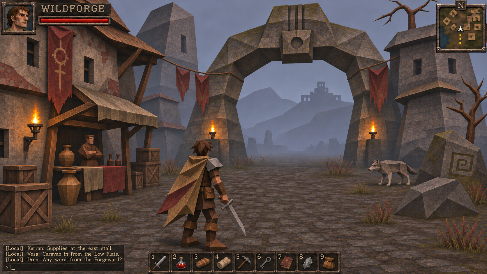

# Визуальный дизайн Wildforge

Версия 1 · 11 ноября 2026

Документ фиксирует направление для последующего производства графики. Пользователь выбрал мрачное ретро конца 1990-х — начала 2000-х, естественные цвета, умеренную детализацию текстур и выраженно полигональные модели. Численные бюджеты и размеры ниже предложены как стартовые параметры и уточняются в тестовой сцене.

[Эталонный кадр](references/wildforge-direction-v1.png) · [Каталог ассетов](ASSETS.md) · [Производство и промпты](PRODUCTION.md)

Эталон создан встроенным imagegen в ходе обсуждения. Он определяет настроение, материалы, силуэты и композицию. Плотность пикселей, геометрия, текст и освещение в нём приблизительные. Архитектура поселения и торговец относятся к предложенному художественному оформлению будущей сцены.

## Художественная идея

Пограничный мир, давно переживший свой расцвет. Каменные поселения построены среди более древних руин. Жители чинят одежду, оружие и дома доступными материалами. Следы использования помогают понять назначение вещей. Мир выглядит обжитым, суровым и немного чужим.

Ориентиры — необычная фэнтезийная атмосфера Morrowind, изношенность материалов классического Fallout, массивная геометрия раннего Quake. Собственные формы архитектуры, символы и персонажи Wildforge развивают эти качества.

Небрежность проявляется в перекошенных деревянных конструкциях, асимметричной экипировке, неодинаковых камнях, заплатах и выцветшей краске. Контроль силуэта, UV и читаемости остаётся точным.

## Геометрия и силуэты

У моделей хорошо видны крупные плоскости. Наплечник состоит из нескольких граней, волосы собираются в угловатые пряди, ботинки имеют клиновидную форму. Тело сохраняет человеческие пропорции. Плащ складывается в несколько больших плоскостей.

Плоские нормали подчёркивают камни, металл, архитектуру и некоторые части одежды. На суставах допускаются сглаженные нормали для аккуратной деформации. Смена освещённости между соседними плоскостями должна быть умеренной.

Герой узнаваем по охристому плащу, одному крупному наплечнику, сапогам и простому мечу. Силуэты врагов различаются массой и позой — вытянутый низкий волк, тонкий скелет, тяжёлый широкоплечий огр, приземистая слизь.

## Цвет и материалы

Палитра служит ориентиром для групп материалов. Количество цветов в текстурах свободное.

| Роль | Пример цвета | Применение |
|---|---|---|
| Камень | #77746B | стены, арки, скалы |
| Светлый камень | #AAA18A | сколы, затёртые края |
| Земля | #635343 | дороги, грунт |
| Дерево | #66503A | балки, двери, ящики |
| Кожа | #49372C | ремни, обувь |
| Охра | #9A7743 | плащ героя, ткань |
| Выцветший красный | #77443A | знамёна, заплаты |
| Растительность | #666B47 | мох, кусты, трава |
| Железо | #65666A | оружие, броня |
| Холодная даль | #7B8495 | туман, небо |
| Огонь | #E3A357 | локальные тёплые акценты |
| Магия | #6FA6B1 | редкие кристаллы и эффекты |

Камень имеет крупные трещины и ограниченное количество мха. Железо тёмное, со светлыми затёртыми кромками. Дерево показывает направление волокон. Ткань имеет несколько читаемых пятен и складок. Грязь располагается у земли, на подоле и в углублениях.

Текстуры сохраняют мелкую читаемую структуру при близком взгляде. Стартовая плотность окружения — около 128 texel на метр. На герое и лице плотность можно повысить. Проверка в рабочей камере определяет окончательный масштаб.

## Свет и изображение

Пасмурное холодное небо даёт мягкое общее освещение. Факелы создают локальные тёплые пятна. Туман постепенно объединяет дальние планы. Выходы и проходы читаются по силуэту и разнице яркости.

Основной материал — diffuse/albedo с высокой roughness. Стартовые roughness — 0.85 для ткани, камня и дерева, 0.55 для старого железа. Metallic железа начать с 0.25 и оценить в сцене. Крупная форма должна читаться через геометрию и свет.

Картинка выводится в разрешении окна. Начальная фильтрация текстур — linear с mipmaps. Для отдельных ассетов проверить nearest с mipmaps, если требуется больше ретро-характера. Предпочтительный результат — мелкая текстура с устойчивой картинкой при движении.

## Камера и масштаб

Основной вид — третье лицо, немного сверху и сзади. Для сцены сравнения использовать дистанцию 8.5 м, FOV 58° и точку взгляда на высоте 1.4 м. Эти значения соответствуют текущей отправной точке клиента.

Для производства принять рост героя 1.8 м. Проверить отношение к текущему игровому масштабу до импорта. Камень для добычи занимает примерно 1 м, дерево — 3–5 м. Проходы и силуэты объектов должны соответствовать реальным коллизиям.

Персонаж должен различаться в спокойном кадре и при максимальном рабочем отдалении камеры. Детали лица оцениваются дополнительно в крупном плане.

## Окружение

Первая художественная сцена — вход в пограничное поселение. Главные формы — древняя арка, две башни, низкие дома, навес, каменная дорога, дальний разрушенный форт.

Крупные формы занимают края кадра и направляют взгляд к проходу. В центре достаточно свободной земли для движения и боя. Декор группируется у стен и препятствий.

Существующие биомы получают общий материалный язык. Луг содержит выцветшую траву и открытые участки грунта. Лес становится темнее и плотнее по краям проходов. Скалы имеют широкие плоскости. Берег использует серо-бежевый песок и приглушённую воду.

## Персонажи и анимация

Герой носит утилитарную одежду. На фоне окружения его выделяет охристый плащ и ясная линия плеч. Смена брони и оружия должна оставаться различимой.

Волк имеет длинную морду, острые уши, выраженную грудь и узкий живот. Скелет читается через просветы между костями. Огр имеет тяжёлые кисти, короткую шею и большой торс. Слизь получает влажную поверхность и простую деформацию объёма.

Анимации экономные, с чёткими ключевыми позами. Ходьба переносит вес между ногами. Удар имеет замах, контакт и возврат. Движение оружия согласовано с рукой. Плащ использует несколько костей или простую ограниченную деформацию.

## Интерфейс

Тёмные железные рамки, потёртые кромки, спокойный светлый текст. Здоровье красное, опыт приглушённо-синий. Иконки предметов имеют отчётливый силуэт и общую постановку света.

Портрет и здоровье располагаются слева сверху, карта справа сверху, панель девяти предметов снизу, чат слева снизу. Инвентарь и крафт получают общий набор рамок. Макет адаптируется к размеру окна.

Основной текст — читаемый шрифт с кириллицей, ориентир 14–16 px при 1280×720. Название игры может использовать отдельное декоративное начертание. Текст интерфейса набирается в движке.

## Первая проверяемая поставка

1. Герой, меч и один комплект одежды.
2. Каменная поверхность, грунт, дерево, ткань и железо.
3. Арка, участок стены, ящик, факел и камень.
4. Волк и дерево для проверки масштаба и силуэтов.
5. Один игровой кадр с существующим HUD и одна сцена осмотра моделей.

Сравнить с эталоном при одинаковых камере, освещении и масштабе. После проверки распространить материалы и правила на остальных врагов и биомы.

## Критерии готовности

- Персонаж и враги узнаваемы по силуэту с игровой дистанции.
- Грани геометрии видны, сочленения аккуратны в движении.
- Текстуры читаются без крупных квадратов, визуальный шум умеренный.
- Тайловые поверхности стыкуются на плоскости 3×3 повторения.
- Цвета предметов сохраняются при холодном свете и возле факела.
- Лицо, кисти, оружие и плащ согласованы между ракурсами.
- Тени и туман сохраняют читаемость проходов.
- UI читается при 1280×720 и 1920×1080.
- Проверены idle, walk, attack, hit и death, отсутствуют разрывы UV и заметные пересечения.
- Производительность проверена в плотном лесу и при нескольких персонажах. Целевой компьютер и численный FPS-бюджет требуется определить перед оптимизацией.
